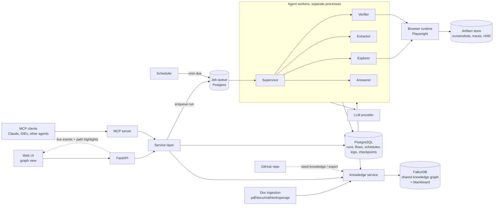
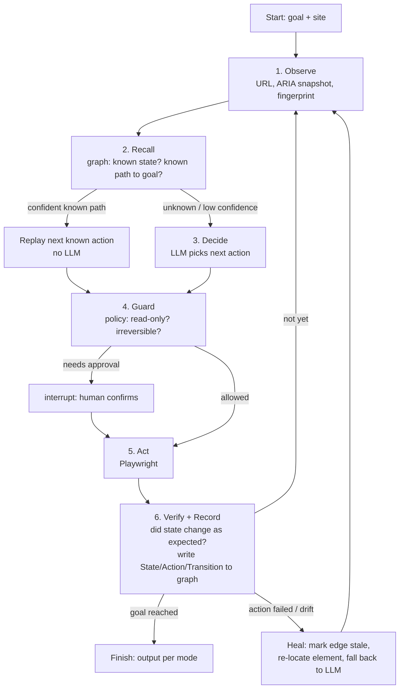

# Sitehive — Architecture

A browser agent that learns websites **as it uses them**. It does not crawl. Each run explores only what the current goal needs, writes what it learned into a knowledge graph, and reuses that knowledge next time. A path it already knows gets replayed deterministically, which is fast and costs no LLM calls. When something is unknown or has changed, the LLM explores, and the graph heals.

## 1. Capabilities

| # | Mode | Input | Output | Side effects on site |
|---|------|-------|--------|----------------------|
| 1 | **Do task** | goal ("save this item", "buy X") | result + run report | yes (needs a confirmation gate) |
| 2 | **Plan steps** | goal | ordered human-readable steps (+ optional Playwright script) | read-only |
| 3 | **Test** | goal + expectations | pass/fail verdict, evidence, trace | usually read-only |
| 4 | **Record & schedule** | user recording or a successful run | parameterized Flow + cron schedule | depends on flow |

All five are built from the same core loop (section 4). They differ in policy (whether writes are allowed), how they terminate, and what they output.

### Hard requirements → where they are met

| Requirement | Priority | Design section |
|---|---|---|
| Multiple agents share notes through the same graph | MUST | §10 Multi-agent blackboard |
| MCP server | MUST | §12 MCP server |
| Explanation for every answer | MUST | §11 Explainability |
| Visual graph in UI with highlighted reasoning path | EXTRA | §14 Graph UI |
| Two or more agents sharing state through the graph | EXTRA | §10, which runs agents as **separate processes** whose only shared channel is FalkorDB |

## 2. High-level architecture



**Components**

- **Service layer**: the single implementation of every operation, such as start a run, ask, explain, load data, or query the graph. The REST API and the MCP server are both thin adapters over it, so they cannot drift apart.
- **API (FastAPI)**: CRUD for sites, tasks, flows, and schedules; starts runs; streams live run events over SSE/WebSocket; resumes runs that are waiting for human confirmation.
- **MCP server**: exposes the same operations as MCP tools and resources (§12).
- **Agents**: role-specialized workers that coordinate through the graph (§10).
- **Doc ingestion**: turns user-imported docs (guides, help articles, SOPs, API specs) into documented site knowledge, linked to what the agents observe (§13).
- **Worker**: picks a run off the queue and executes a LangGraph graph against one isolated browser context.
- **Scheduler**: a small loop that reads the `schedules` table and enqueues due runs. The data lives in Postgres, so there is no separate cron infrastructure.
- **Browser runtime**: Playwright (Chromium). Owns contexts, session state (`storage_state`), observation, action execution, and tracing.
- **Knowledge service**: the only code that talks to FalkorDB. Exposes `recall(state, goal)`, `record_transition(...)`, `find_path(from, to)`, and `facts_for(question)`.
- **PostgreSQL**: all transactional and operational data, plus the LangGraph checkpointer.
- **Artifact store**: local disk in dev, S3/MinIO in prod.

## 3. Technology decisions

| Concern | Choice | Why |
|---|---|---|
| Relational DB | **PostgreSQL** (not MySQL) | Official LangGraph checkpointer (`langgraph-checkpoint-postgres`), JSONB for event payloads, `pgvector` for semantic recall later, `SKIP LOCKED` for a DB-backed job queue. MySQL gives none of these. |
| Job queue | **procrastinate** (Postgres-backed) | No Redis or RabbitMQ to operate; retries and locking are built in. Swap to arq/Celery only if throughput demands it. |
| Agent orchestration | **LangGraph** | Explicit state machine, checkpoint/resume, `interrupt()` for human-in-the-loop on purchases. |
| Browser | **Playwright directly**; browser-use optional | We need to own the observe→act loop so every step can be read from and written to the graph. browser-use runs its own agent loop, which competes with LangGraph. Reuse its ideas (DOM distillation, element indexing), or wrap it as one "free explore" tool node for hard cases. |
| Page representation for LLM | ARIA snapshot (`locator.aria_snapshot()`) + distilled interactive elements + optional screenshot | Compact, semantic, and gives stable locators (role + name). |
| Graph DB | **FalkorDB** | Cypher, fast path queries, and vector index support for semantic element/page matching. |
| LLM tracing | Langfuse (self-host) or LangSmith | Prompt- and token-level debugging, kept separate from run logs. |
| Packaging | `uv`, Python 3.12 | Fast, lockfile. |

## 4. The core loop (explore on the go)

Every mode runs this loop. Steps 2 and 6 make the system learn.



- **State fingerprint**: a hash of (normalized URL template + the set of visible landmark/interactive roles and names). Similar pages, such as product/123 and product/456, map to the same **Page** template but can be different **States** (cart empty vs. cart full).
- **Confidence**: each transition edge stores `success_count`, `fail_count`, and `last_verified_at`. Replay happens only above a threshold. Failures decay confidence and trigger healing.
- **Budget**: max steps, max LLM calls, and wall-clock time per run, enforced in graph state.
- **Doc-guided recall**: when no observed path exists, Recall looks for a documented `Procedure` matching the goal and hands its steps to Decide as a plan (§13).

## 5. Knowledge graph model (FalkorDB)

```
(:Site {domain})
(:Page {url_template, title, kind})                 -[:ON_SITE]->(:Site)
(:State {fingerprint, summary, embedding})          -[:OF_PAGE]->(:Page)
(:Element {role, name, locators[], stability})      -[:IN_STATE]->(:State)
(:State)-[:TRANSITION {action, element_id, input_kind,
                       success_count, fail_count, last_verified_at}]->(:State)
(:Form)-[:HAS_FIELD]->(:Field {label, type, required, param_name})
(:Goal {text, embedding})-[:ACHIEVED_BY]->(:Flow)
(:Flow {id})-[:STARTS_AT]->(:State)                  // mirrors Postgres flow
(:Fact {text, value, observed_at, ttl})-[:SOURCED_FROM]->(:State)
(:Capability {name: "add_to_cart" | "login" | "search" ...})-[:AVAILABLE_IN]->(:State)

// multi-agent collaboration (§10)
(:Agent {id, role, process_id})
(:Run {id, mode, goal})-[:HAS_TASK]->(:WorkItem {id, kind, status, claimed_at})
(:WorkItem)-[:CLAIMED_BY]->(:Agent)
(:Note {id, kind, text, confidence, created_at})-[:WRITTEN_BY]->(:Agent)
(:Note)-[:ABOUT]->(any node)          (:Note)-[:IN_RUN]->(:Run)
(:Note)-[:DERIVED_FROM]->(:Note|:Fact|:Record)
(:Note)-[:CONTRADICTS|:CONFIRMS]->(:Note|:Fact)

// explainability (§11)
(:Answer {id, text, confidence})-[:ANSWERS]->(:Question {text})
(:Answer)-[:SUPPORTED_BY {rank, role}]->(:Fact|:Record|:Note|:State)
(:Run)-[:PRODUCED]->(:Answer)

// documented knowledge from ingested docs (§13)
(:Document {id, title, source_type, uri, sha256, version, loaded_at})
(:Section {heading_path, order})-[:IN_DOC]->(:Document)
(:Chunk {id, text, page, embedding})-[:IN_SECTION]->(:Section)
(:Concept {name, definition, aliases[]})
(:Feature {name, description, status})
(:Procedure {goal, embedding, status: documented|confirmed|drifted|outdated})
(:Procedure)-[:HAS_STEP {order}]->(:DocStep {instruction, ui_hint, expected})
(:Rule {text, kind: constraint|policy|validation, status})
(:ScreenHint {name, nav_path[], url_hint})
(:Endpoint {method, path})                                       // from OpenAPI
(:Concept|:Feature|:Procedure|:Rule|:ScreenHint)-[:MENTIONED_IN {quote}]->(:Chunk)

// documented ↔ observed links
(:ScreenHint)-[:MATCHES]->(:Page)
(:Feature)-[:SAME_AS]->(:Capability)
(:DocStep)-[:REALIZED_BY]->(:Element)    (:DocStep)-[:LEADS_TO]->(:State)
(:Procedure)-[:REALIZED_AS]->(:Flow)
(:Rule)-[:APPLIES_TO]->(:Page|:Form|:Feature)

// structured data, secondary (§13)
(:Dataset {id, name, source_type, uri, loaded_at, row_count})
(:Record {dataset_id, row_key})-[:FROM_DATASET]->(:Dataset)
(:Record)-[:SAME_AS {method, score}]->(:State|:Element|:Fact)
```

- **Element locators** are stored as an ordered list: `role+name` → `label/placeholder` → `test-id` → CSS. Healing promotes whichever one worked.
- **Never store secrets or PII values.** Store field *kinds* (`email`, `card_number`) and parameter names only.
- **Facts** (for Q&A) carry `observed_at` and a TTL. Stale facts trigger a re-visit instead of being answered from cache.
- Per-tenant isolation: one FalkorDB graph per workspace (`graph:<workspace_id>`). Site structure could be shared across tenants later, but user-specific states must never be.

## 6. Relational model (PostgreSQL)

```
workspaces, users
sites               (id, workspace_id, base_url, auth_profile_id)
auth_profiles       (id, site_id, encrypted storage_state, credential_ref)
tasks               (id, mode, goal, params jsonb, policy jsonb)
runs                (id, task_id|flow_id, status, started_at, ended_at, cost, result jsonb)
run_steps           (id, run_id, seq, observation_ref, decision, action jsonb,
                     source: 'graph'|'llm'|'human', outcome, duration_ms, screenshot_ref)
run_events          (id, run_id, ts, level, type, payload jsonb)   -- structured logs
flows               (id, site_id, name, version, steps jsonb, params_schema jsonb, origin: 'recorded'|'promoted_run')
schedules           (id, flow_id, cron, timezone, params jsonb, enabled, next_run_at)
approvals           (id, run_id, step_id, prompt, decision, decided_by, decided_at)
documents           (id, workspace_id, site_id, title, source_type, uri, artifact_id,
                     sha256, version, status)
datasets            (id, workspace_id, site_id, name, source_type, uri, mapping jsonb, status)
ingest_jobs         (id, document_id|dataset_id, started_at, ended_at,
                     chunks, nodes_upserted, edges_upserted, errors jsonb)
artifacts           (id, run_id, kind, uri)
langgraph checkpoint tables (managed by langgraph-checkpoint-postgres)
```

### Logging strategy (three layers)

1. **Run timeline**: `run_steps` and `run_events` in Postgres. The UI reads these, users see them, and they can be queried.
2. **Artifacts**: Playwright trace zip, screenshots per step, and an optional HAR file, all in the object store and referenced from `artifacts`.
3. **App/infra logs**: `structlog` JSON to stdout, collected by Docker/Loki. LLM traces go to Langfuse.

Partition `run_events` by month once volume grows, and set a retention policy on artifacts.

## 7. How each mode maps to LangGraph

Shared subgraph: `navigate_loop` (section 4). Mode graphs wrap it:

- **do_task**: `plan → navigate_loop(policy=write_with_approval) → summarize`. Irreversible actions (submit payment, place order, delete, send) are classified in the Guard node and **always** go through `interrupt()` unless the user has pre-authorized that exact flow.
- **plan_steps**: `recall_path` first. If the graph already has a path, steps come straight from the graph with no browser needed. Otherwise it runs `navigate_loop(policy=read_only, stop_before_irreversible=True)` and emits steps, which can optionally compile to a Playwright `.py` script.
- **test**: `navigate_loop(read_only)` plus an `assert` node that checks expectations against observations (text visible, URL, element state, optional screenshot diff), then produces a verdict and evidence.
- **answer**: `recall_facts` (fresh enough?) → if not, `navigate_loop(read_only, goal="find info")` → `extract` → `answer_with_citations`. It returns "not found" instead of guessing, and every answer cites the page and time. This keeps the "dicey" mode honest.
- **replay_flow** (scheduled): deterministic step execution from `flows.steps`. Each step falls back to the healing path on failure. If healing changes the flow, it writes a new flow **version** rather than mutating in place.

## 8. Recording flows

Two sources for a Flow:

1. **Promote a run**: any successful run can be saved as a flow. The steps already exist in `run_steps`, and literal inputs get parameterized (`{{email}}`, `{{quantity}}`).
2. **User recording**: open a headed browser with an injected recorder script (or capture CDP input events), emit semantic steps (`click role=button name="Add to cart"`), then parameterize.

A flow step looks like this:

```json
{"action": "fill", "target": {"role": "textbox", "name": "Email"},
 "fallbacks": ["#email", "[name=email]"], "value": "{{email}}",
 "expect": {"url_matches": "/checkout"}}
```

## 9. Security and safety

- **Credentials vault**: secrets are encrypted at rest (start with Fernet + a KMS key) and injected at action time by reference. **The LLM only ever sees `{{password}}`, never the value.**
- **Session reuse**: an encrypted Playwright `storage_state` per auth profile avoids repeated logins and CAPTCHAs.
- **Policy engine**: per task, an allowed domain list, read-only vs. write mode, a spend cap, and an irreversible-action classifier backed by an approval gate.
- **Prompt-injection defense**: page content is untrusted data. It goes into the prompt in a delimited "observation" section, and the agent never follows instructions found on a page that change its goal or policy.
- Respect site ToS/robots, and rate-limit per domain.

## 10. Multi-agent blackboard (agents share notes through the graph)

The graph is the **blackboard**. Agents never message each other directly. They read and write `Note`, `Fact`, and `WorkItem` nodes in FalkorDB. Because the only coordination channel is the graph, every exchange between agents is queryable, explainable, and visible in the UI.

| Agent | Reads | Writes |
|---|---|---|
| **Supervisor** | goal, existing knowledge | `WorkItem`s ("explore checkout", "extract prices from /laptops"), final assembly |
| **Reader** | uploaded documents | `Concept`, `Feature`, `Procedure`/`DocStep`, `Rule`, `ScreenHint`, `Note{kind:doc_summary}` |
| **Explorer** | `WorkItem`s of kind `explore`, known transitions | `State`, `Element`, `TRANSITION`, `Note{kind:observation}` |
| **Extractor** | `State`s flagged by Explorer, loaded `Record`s | `Fact`, `SAME_AS` links to loaded data, `Note{kind:finding}` |
| **Verifier** | low-confidence `Fact`s and `Note`s, documented claims vs. observed states | `CONFIRMS` / `CONTRADICTS` edges, doc statuses (`confirmed`/`drifted`), `Note{kind:verification}` |
| **Answerer** | the supporting subgraph | `Answer`, `SUPPORTED_BY` edges, explanation |

**Coordination mechanics**

- **Claiming work**: an agent claims a `WorkItem` atomically, matching `status:'open'` and setting `status:'claimed'` plus a `CLAIMED_BY` edge in one query. FalkorDB executes write queries serially per graph, so two agents cannot claim the same item. Claims carry a lease (`claimed_at`). The Supervisor reopens expired claims.
- **Waking up**: agents poll for new open items (a cheap indexed query every 1–2 s) or listen on a Redis pub/sub channel on the same FalkorDB instance (`run:<id>:events`). Pub/sub is only a doorbell. The data always lives in the graph.
- **Idempotent writes**: all knowledge writes use `MERGE` on natural keys (fingerprint, url_template, row_key), so concurrent agents discovering the same page converge to one node.
- **Cross-run memory**: notes persist beyond the run. A later run's Explorer recalls "Note: coupon field only appears after login" written by a different agent last week.
- **Two-process demo**: start Explorer and Extractor as separate OS processes (`sitehive agent explorer`, `sitehive agent extractor`). They share nothing but the FalkorDB connection string. This is the proof for "agents sharing state through the graph".

In LangGraph, each agent is its own compiled graph with its own checkpoint thread. The Supervisor is a LangGraph graph that creates `WorkItem`s and waits (via `interrupt` or polling) until they are done. Inside one process, the Supervisor can also call agents as subgraphs for simple runs. The graph protocol stays the same either way.

## 11. Explainability (an explanation for every answer)

**Rule: no output leaves the system without an explanation object.** This applies to answers, task results, test verdicts, and generated steps. The explanation is built from the graph, not invented by the LLM after the fact.

```json
{
  "answer": "The ThinkPad X1 is the best-rated laptop under $1000 that is in stock.",
  "confidence": 0.82,
  "explanation": {
    "summary": "Catalog data lists 4 laptops under $1000. The live site shows 2 in stock; of those, the X1 has the higher rating.",
    "steps": [
      {"claim": "4 laptops under $1000", "evidence": ["record:catalog.csv#12", "record:catalog.csv#19", "..."]},
      {"claim": "X1 is in stock", "evidence": ["fact:f_88"], "source": {"url": "https://shop.test/p/x1", "observed_at": "2026-10-15T14:02Z", "screenshot": "artifact:..."}, "verified_by": "agent:verifier"}
    ],
    "path": {"nodes": ["q_1", "rec_12", "fact_88", "state_41", "ans_1"], "edges": ["e_1", "e_2", "e_3", "e_4"]},
    "agents": ["explorer", "extractor", "verifier", "answerer"],
    "caveats": ["Stock observed 3 minutes ago; may change."]
  }
}
```

How it is produced:

1. **Evidence is recorded at write time.** Every `Fact` has `SOURCED_FROM` a `State` (URL, timestamp, screenshot). Every `Note` has `WRITTEN_BY` an agent and `DERIVED_FROM` its inputs. Every action in a run step records `source: graph|llm|human` and a short rationale.
2. **The Answerer must cite node ids.** Its structured output (a Pydantic schema) requires an evidence list per claim. A validator rejects claims whose evidence ids don't exist in the graph and re-prompts once. If the claim still has no support, the answer becomes "not found", with what was tried.
3. **The path is computed, not narrated**: the Answerer's `SUPPORTED_BY` edges plus their provenance chains (`Fact→State`, `Note→DERIVED_FROM`, `Procedure→MENTIONED_IN→Chunk→Document`, `Record→Dataset`) form the reasoning subgraph. That subgraph is what the UI highlights (§14).
4. **Per mode**:
   - *answer*: claims and evidence as above.
   - *do_task / replay*: each step says *why* it was taken ("known transition, 14/14 successes" or the LLM's rationale) and what verified it.
   - *test*: each assertion lists expected vs. observed, with a screenshot.
   - *plan_steps*: each step is marked as learned (graph edge id) or proposed (unverified).

## 12. MCP server

Built with the official `mcp` Python SDK (`FastMCP`). It supports **stdio** (Claude Desktop, IDEs) and **streamable HTTP** (remote clients). It calls the service layer, never the database directly.

**Tools**

| Tool | Purpose |
|---|---|
| `ask(site, question)` | Q&A mode → answer + explanation |
| `run_task(site, goal, params?)` | do-task mode. Returns `run_id`; irreversible steps wait in `pending_approval` |
| `approve(run_id, step_id, decision)` | resolve a pending approval |
| `plan_steps(site, goal)` | steps + explanation |
| `test_site(site, goal, expectations[])` | verdict + evidence |
| `get_run(run_id)` / `get_explanation(run_id)` | status, timeline, reasoning subgraph |
| `list_flows(site?)` / `run_flow(flow_id, params)` / `schedule_flow(flow_id, cron, params)` | flows |
| `ingest_document(site, path_or_url)` | §13: import a doc (PDF/DOCX/MD/HTML/OpenAPI) as site context |
| `search_docs(site, query)` | semantic search over ingested doc chunks, with citations |
| `doc_status(site)` | documented procedures and whether each is confirmed, drifted, or not yet tried |
| `load_dataset(source, mapping)` | §13 structured CSV/JSON loader |
| `query_graph(cypher, params?)` | **read-only** Cypher (rejects write clauses; row and time limits) |
| `add_note(about_node_id, text, kind)` | lets an *external* agent join the blackboard as another collaborator |
| `search_knowledge(text, site?)` | semantic/keyword search over States, Facts, Notes, Records |

**Resources**: `graph://schema` (labels, relationships, properties), `site://{domain}/summary` (known pages, capabilities, flows), `run://{id}/explanation`.

**Prompts**: `investigate_site`, `explain_answer`, both reusable templates for MCP clients.

The MCP server makes sitehive itself an agent tool. Another agent, such as Claude in an IDE, can become one more participant on the blackboard by calling `add_note` and `search_knowledge`.

## 13. Data loader: document ingestion → site context

Users import documentation about the site: user guides, help-center articles, SOPs, onboarding docs, release notes, and API specs. Sitehive turns them into **documented knowledge** in the graph, meaning what the site is *supposed* to have and how it is *supposed* to work. Agents use this as a head start before exploring.

The graph then holds two kinds of knowledge, and the gap between them is useful:

| | **Documented** (from docs) | **Observed** (from browsing) |
|---|---|---|
| Source | Reader agent ingesting files | Explorer/Extractor in a live browser |
| Nodes | `Concept`, `Feature`, `Procedure`/`DocStep`, `Rule`, `ScreenHint` | `Page`, `State`, `Element`, `TRANSITION`, `Fact` |
| Trust | a claim (`status: documented`) | evidence (`observed_at`, screenshot) |
| Linked by | `MATCHES`, `REALIZED_BY`, `REALIZED_AS` edges, with status updated to `confirmed`, `drifted`, or `outdated` | |

### Supported inputs

| Type | Examples | Parser |
|---|---|---|
| PDF, DOCX, PPTX | user manual, SOP, training deck | **docling** (layout-aware: headings, lists, tables, reading order) |
| Markdown, HTML, TXT | help-center export, Notion/Confluence export, README | docling / markdown-it |
| Doc URL | a help article the user points at | fetch that one URL (no crawling), then HTML parser |
| API spec | OpenAPI / Swagger JSON or YAML | native parser → `Endpoint` nodes |
| Structured data (secondary) | CSV / JSON API (catalog, test accounts) | row mapper from the YAML mapping (below) |

### Pipeline

`store → parse → chunk → embed → extract → canonicalize → link → verify (ongoing)`

1. **Store**: save the raw file in the artifact store and record it in `documents` (sha256, version). Re-uploading an unchanged file is a no-op. A changed file creates a new version, and nodes extracted only from removed sections are marked `outdated`.
2. **Parse**: docling converts the file into a structured document tree (headings, paragraphs, lists, tables, page numbers).
3. **Chunk by structure, not by size**: each section is split along its heading path (`Help > Billing > Update card`). Numbered lists stay intact because they are usually procedures. Each chunk keeps `heading_path` and `page` for citations.
4. **Embed**: chunk embeddings go into a FalkorDB vector index for `search_docs` and goal matching.
5. **Extract (LLM, structured output)**: per section, the extractor fills a Pydantic schema:
   - **Concept**: a domain term and its definition ("Workspace: a container for projects").
   - **Feature**: a capability the site offers ("Export report as CSV").
   - **Procedure**: a goal plus ordered **DocSteps**. Each step has an instruction, a `ui_hint` (`nav_path: ["Settings","Billing"]`, `action: click`, `target_label: "Update card"`), and an optional expected result.
   - **Rule**: a constraint, policy, or validation ("Coupons require login", "Returns within 30 days", "Password ≥ 12 chars").
   - **ScreenHint**: a named screen and how to reach it ("Billing page, under Settings"), with a URL if the doc gives one.
   - **Endpoint** (from OpenAPI): method, path, and parameters, later matched to network calls seen while browsing.

   **Every extracted item must cite its chunk and a verbatim quote.** Items whose quote doesn't appear in the chunk are dropped. This is the same evidence rule as §11.
6. **Canonicalize**: the same feature or procedure described in several docs is merged by embedding similarity plus an LLM tie-break. Each node keeps every `MENTIONED_IN` source.
7. **Link to observed knowledge**: runs at ingest time and again whenever agents discover new pages:
   - `ScreenHint -[:MATCHES]-> Page` (URL or title/heading match)
   - `Feature -[:SAME_AS]-> Capability`
   - `DocStep -[:REALIZED_BY]-> Element` and `-[:LEADS_TO]-> State`, once Explorer performs that step
   - `Procedure -[:REALIZED_AS]-> Flow`, once a run completes it end to end
   - `Rule -[:APPLIES_TO]-> Page|Form|Feature`
8. **Verify (ongoing)**: when the Explorer follows a procedure and the site differs (the button is renamed, or the menu moved), it writes `Note{kind: doc_drift}` about the `DocStep`, and the Verifier sets the procedure's status to `drifted`. Matches move it to `confirmed`.

### How agents use the docs

- **Recall/Decide (§4)**: if the graph has no observed path to the goal, recall finds the closest `Procedure` by embedding and passes its DocSteps to the Decide node as a plan. The LLM follows the documented route instead of wandering, which means fewer steps and fewer tokens.
- **Plan steps**: answers instantly from docs when nothing is observed yet. Each step is labeled **documented (unverified)**, **confirmed**, or **drifted**.
- **Test**: `Rule`s and DocStep expectations become candidate assertions. This enables a **doc-accuracy test**: "run every documented procedure and report which docs are out of date".
- **Explanations**: cite doc evidence with its heading path, page, and quote ("User Guide p.14, *Billing › Update card*: 'Click **Update card** under Settings → Billing'"), next to observed evidence.
- **Trust**: docs are user-provided but still treated as **data, not instructions**. A sentence in a doc can't change the agent's policy, approvals, or allowed domains.

### Structured data (secondary path)

CSV or JSON API data, such as a product catalog or a list of test accounts, still loads through a declarative YAML mapping into `Record` nodes, with no code per dataset:

```yaml
dataset: shop_catalog
source: {type: csv, path: datasets/demo_shop/products.csv}
nodes:
  - label: Product
    key: sku                         # MERGE key → idempotent reloads
    properties: {name: name, price: {col: price, type: float}}
link:                                 # entity resolution to browsed knowledge
  - label: Product
    match: [{by: url, col: product_url}, {by: name_fuzzy, col: name, threshold: 0.9}]
```

Rows are upserted in batches with `UNWIND … MERGE`. Bad rows go to `ingest_jobs.errors` without aborting the load, and every node links back to its `Dataset`.

Entry points: CLI `sitehive ingest docs/user-guide.pdf --site shop.test`, REST `POST /sites/{id}/documents` (multipart upload), MCP `ingest_document`.

## 14. Graph UI with the highlighted reasoning path

- **Library**: Cytoscape.js. It handles thousands of nodes, has good layouts (`fcose`, `dagre` for paths), and makes per-element styling easy for highlights. Use `react-cytoscapejs` in a Vite + React frontend.
- **Endpoints**:
  - `GET /runs/{id}/explanation`: the reasoning subgraph (nodes, edges, and `path` ids in order)
  - `GET /graph/neighborhood?node=…&depth=2`: expand on click
  - `GET /runs/{id}/events` (SSE): live events such as `node_created`, `note_written`, `path_step`, `work_claimed`
- **Views**:
  - **Explanation view**: the answer on the left and the subgraph on the right. The reasoning path is drawn bold and animated in order, with everything else dimmed. Clicking a node shows its provenance (URL, screenshot, CSV row, authoring agent).
  - **Live run view**: nodes appear as agents write them, **colored by authoring agent**, so viewers can watch Explorer and Extractor collaborate on the shared graph.
  - **Site map view**: States and transitions, with edge thickness proportional to success count. Stale edges are shown in red.

## 15. GitHub repo integration: yes, but phase 3

It is useful, but not core to the learning loop. Planned uses:

- **Import (seed knowledge)**: read an existing Playwright/Cypress test suite, or a markdown runbook, and convert its steps into graph transitions and flows. The site is "pre-learned" before the first run.
- **Export (flows as code)**: commit recorded or learned flows as Playwright test files and open a PR. Teams then get maintained E2E tests for free.
- **Source-aware testing** (later): if the user's own app repo is connected, read routes, components, and `data-testid`s to get better locators and expectations.

Don't make the agent depend on a repo. Many target sites aren't the user's own.

## 16. Folder structure

```
sitehive/
├── pyproject.toml              # uv-managed; one package, extras for dev/test
├── uv.lock
├── docker-compose.yml          # postgres, falkordb, minio (optional), langfuse (optional)
├── .env.example
├── alembic.ini
├── docs/
│   ├── ARCHITECTURE.md
│   └── adr/                    # one file per decision (e.g. 0001-postgres-over-mysql.md)
├── migrations/                 # alembic versions
├── src/sitehive/
│   ├── config.py               # pydantic-settings
│   ├── services/               # the one implementation: runs.py, ask.py, explain.py,
│   │                           # datasets.py, graph_query.py, flows.py (API + MCP call these)
│   ├── mcp_server/
│   │   ├── server.py           # FastMCP app, stdio + streamable HTTP
│   │   ├── tools.py            # thin wrappers over services/
│   │   ├── resources.py        # graph://schema, site://…/summary, run://…/explanation
│   │   └── prompts.py
│   ├── api/
│   │   ├── main.py             # FastAPI app factory
│   │   ├── deps.py
│   │   ├── routes/             # sites.py, tasks.py, runs.py, flows.py, schedules.py, approvals.py
│   │   └── events.py           # SSE/WebSocket live run stream
│   ├── agents/
│   │   ├── state.py            # typed LangGraph state
│   │   ├── policy.py           # read-only / approval / budget rules
│   │   ├── roles/              # one LangGraph graph per agent role, runnable as its own process
│   │   │   ├── supervisor.py
│   │   │   ├── reader.py       # runs doc ingestion as a blackboard participant
│   │   │   ├── explorer.py
│   │   │   ├── extractor.py
│   │   │   ├── verifier.py
│   │   │   └── answerer.py
│   │   ├── blackboard.py       # claim/release WorkItems, write/read Notes, doorbell pub/sub
│   │   ├── graphs/
│   │   │   ├── navigate_loop.py   # shared subgraph (observe→recall→decide→guard→act→verify)
│   │   │   ├── do_task.py
│   │   │   ├── plan_steps.py
│   │   │   ├── test_site.py
│   │   │   ├── answer.py
│   │   │   └── replay_flow.py
│   │   ├── nodes/              # observe.py, recall.py, decide.py, guard.py, act.py,
│   │   │                       # verify.py, record.py, heal.py, extract.py, assert_.py
│   │   └── prompts/            # versioned prompt templates
│   ├── browser/
│   │   ├── pool.py             # browser/context lifecycle, concurrency limits
│   │   ├── session.py          # storage_state load/save
│   │   ├── observe.py          # aria snapshot, element distillation, screenshots
│   │   ├── actions.py          # typed action schema + executor
│   │   ├── locators.py         # semantic locator resolution + healing
│   │   ├── fingerprint.py      # URL templating + state hashing
│   │   └── recorder/           # injected JS recorder + event → step conversion
│   ├── knowledge/
│   │   ├── client.py           # FalkorDB connection, per-workspace graph
│   │   ├── schema.py           # node/edge models, indexes
│   │   ├── repository.py       # recall, record_transition, find_path, facts
│   │   └── cypher/             # .cypher query files
│   ├── explain/
│   │   ├── models.py           # Explanation / Claim / Evidence schemas
│   │   ├── builder.py          # answer + SUPPORTED_BY → reasoning subgraph + path
│   │   └── validator.py        # reject claims citing non-existent evidence
│   ├── ingest/
│   │   ├── documents/
│   │   │   ├── parse.py        # docling → structured doc tree (pdf/docx/pptx/md/html)
│   │   │   ├── chunk.py        # heading-path chunking, keep lists/tables intact
│   │   │   ├── extract.py      # LLM structured extraction (Concept/Feature/Procedure/Rule/ScreenHint)
│   │   │   ├── schemas.py      # Pydantic extraction schemas, quote-evidence validation
│   │   │   ├── canonicalize.py # merge duplicates across docs
│   │   │   └── openapi.py      # spec → Endpoint nodes
│   │   ├── structured/         # csv.py, json_api.py, mapping.py (YAML → nodes/edges)
│   │   ├── linker.py           # documented ↔ observed links (MATCHES, REALIZED_BY, SAME_AS)
│   │   ├── upsert.py           # batched UNWIND/MERGE, index creation
│   │   └── versioning.py       # sha256 dedupe, re-ingest diff, mark outdated
│   ├── flows/
│   │   ├── models.py           # Flow/Step pydantic models
│   │   ├── parameterize.py
│   │   ├── compile_playwright.py   # flow → Playwright script
│   │   └── versioning.py
│   ├── scheduler/
│   │   └── tick.py             # due schedules → enqueue
│   ├── workers/
│   │   ├── app.py              # procrastinate app
│   │   └── tasks.py            # run_task, run_flow
│   ├── db/
│   │   ├── session.py          # async SQLAlchemy
│   │   ├── models/             # one module per aggregate
│   │   └── repositories/
│   ├── storage/
│   │   └── artifacts.py        # local/S3 abstraction
│   ├── security/
│   │   ├── vault.py            # encrypted credentials, placeholder injection
│   │   └── guardrails.py       # irreversible-action classifier, domain allowlist
│   ├── integrations/
│   │   └── github/             # import tests/runbooks, export flows as PRs (phase 3)
│   ├── observability/
│   │   ├── logging.py          # structlog setup
│   │   └── tracing.py          # Langfuse hooks
│   └── cli.py                  # `sitehive run|ask|load|agent <role>|mcp` for dev
├── datasets/
│   └── demo_shop/              # help-center docs (user-guide.pdf, returns-policy.md, faq.md),
│                               # openapi.yaml, optional products.csv + mapping.yaml
├── frontend/                   # Vite + React + Cytoscape.js
│   └── src/
│       ├── views/              # ExplanationView, LiveRunView, SiteMapView, RunsList
│       ├── graph/              # cytoscape styles, path animation, agent color scheme
│       └── api/                # REST + SSE client
└── tests/
    ├── unit/                   # fingerprinting, locators, parameterization, policy
    ├── integration/            # against Postgres + FalkorDB in docker
    └── e2e/
        └── fixture_sites/      # small local HTML shop/form sites for deterministic agent tests
                                # (demo_shop site matches datasets/demo_shop docs, but one documented
                                #  procedure is deliberately outdated so doc-drift detection shows up)
```

## 17. Build order (must-haves first)

1. **Phase 0, skeleton**: docker-compose (Postgres + FalkorDB), config, CLI that opens a site and dumps an observation, and the fixture demo shop site.
2. **Phase 1, the must-have slice** (enough for a full demo):
   - Doc ingestion for PDF + Markdown (docling → heading chunks → Procedure/Rule/ScreenHint extraction with quote evidence), run by the Reader agent.
   - Explorer and Extractor as separate processes sharing the graph (WorkItems + Notes), with Explorer following documented procedures.
   - The `answer` mode end to end, with the Answerer, evidence validation, and the explanation object.
   - MCP server exposing `ask`, `get_explanation`, `query_graph`, `ingest_document`, `search_docs`, `add_note`, `search_knowledge`.
3. **Phase 2, extras**: the graph UI (explanation view with highlighted path, live run view colored by agent), the Verifier agent with doc-drift detection, DOCX/HTML/OpenAPI ingestion, the structured CSV/JSON loader, and the `plan_steps` / `test` modes.
4. **Phase 3, actions with safety**: `do_task` with the approval interrupt, vault, and session reuse. Flows: promote-run → flow → replay with healing. Scheduler.
5. **Phase 4**: the user recorder, the GitHub import/export, and LLM-suggested CSV mappings.

**Demo script**: upload the demo shop's `user-guide.pdf` → the Reader's Procedure and Rule nodes appear in the graph → ask over MCP from Claude: "How do I apply a coupon, and does it work for guest checkout?" → the Explorer follows the documented procedure, finds the coupon field has moved, and writes a `doc_drift` note; the Verifier marks the procedure `drifted` → the answer comes back with an explanation citing both the doc (page + quote) and the live page (screenshot) → the UI highlights the path Question → Procedure → DocStep → observed State → Rule → Answer.

Measure from phase 1 onward: the **replay hit rate** (steps served from the graph vs. the LLM) and the **heal success rate**. These two numbers show whether the graph is earning its keep.
